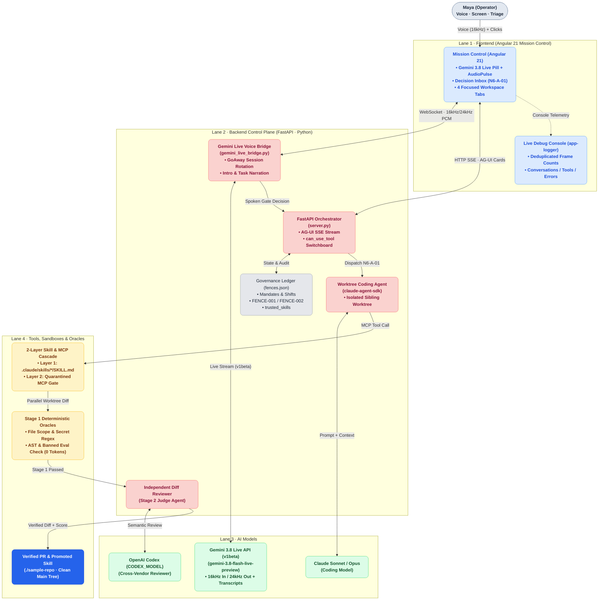

# Axiom Software Factory — Multi-Lane Architecture & Sequence Diagram Specification

**Purpose:** Visual and declarative diagram specification modeled after the reference Google Cloud / Agentic style guide (soft pastel role pills, `#F8F9FA` container zones, `#2563EB` solid/dashed connectors with dot endpoints, and pill-shaped inline edge labels) for rendering via an external diagram service (Figma, Excalidraw, D2, Mermaid, or SVG generator).

---

## 1. Visual Style & Color Palette Specification (From Reference Images)

| Role / Category | Fill Color | Text / Accent Color | Components Assigned to This Role |
| :--- | :--- | :--- | :--- |
| **User / Operator** | `#E2E8F0` (Soft Slate Pill) | `#1E293B` (Dark Slate) | **Maya (Operator)** · Voice (`16kHz PCM`) + Linear Triage |
| **Frontend (UI Plane)** | `#DBEAFE` (Pastel Blue) | `#1D4ED8` (Royal Blue) | **Mission Control (Angular 21)** · `GeminiLiveAudioService` · `AudioPulse` · `Decision Inbox` · `LoggerConsole` |
| **Backend & Agents** | `#FCE7F3` / `#FAD2CF` (Pastel Coral) | `#881337` (Deep Rose) | **FastAPI Control Plane (`server.py`)** · **Gemini Live Bridge (`gemini_live_bridge.py`)** · **Claude Agent Worker (`claude-agent-sdk`)** · **Stage 2 Reviewer (`Codex`)** |
| **AI Models** | `#DCFCE7` (Pastel Mint Green) | `#14532D` (Forest Green) | **Gemini 3.8 Live (`gemini-3.8-flash-live-preview`)** · **Claude Sonnet/Opus** · **OpenAI Codex (`CODEX_MODEL`)** |
| **Tools, Sandboxes & Oracles** | `#FEF3C7` (Pastel Amber/Yellow) | `#78350F` (Warm Brown) | **2-Layer Skill Cascade (`can_use_tool`)** · **MCP Elicitation Gate** · **Isolated Git Worktree** · **Stage 1 Deterministic Oracles** |
| **State & Ledger** | `#E5E7EB` (Neutral Gray Card) | `#1F2937` (Charcoal) | **Governance Ledger (`fences.json`)** · **Layer 1 `.claude/skills/*/SKILL.md`** |
| **Verified Output** | `#2563EB` (Solid Primary Blue) | `#FFFFFF` (White) | **Verified Worktree Diff / PR (`sample-repo`)** |
| **Connectors & Labels** | Line: `#2563EB` (`1.5px` solid/dashed) | Pill Label: `#E2E8F0` bg / `#334155` text | Solid line = request / stream; Dashed line = callback / gate signal; Endpoints = `●` (`4px` circle) |

---

## 2. Diagram A — Multi-Lane System Architecture (Frontend · Backend · Models · Tools & Sandboxes)

```text
===================================================================================================================================
  LANE 1: OPERATOR & FRONTEND (ANGULAR 21 MISSION CONTROL — `frontend-angular/`)
===================================================================================================================================

      (      Maya (Operator)      )
      (  Voice · Screen · Triage  )
                    │
         [ 16kHz Mic / 24kHz Speaker ]
                    │
                    ▼
  ┌───────────────────────────────────────────────┐
  │  BLUE CARD (#DBEAFE):                         │
  │  Mission Control (Angular 21)                 │
  │  ───────────────────────────────────────────  │
  │  • Header: Gemini 3.8 Live Pill + AudioPulse  │      ●─── [ WS /ws/live/{id} · 16k/24k PCM + Narration ] ───● (To Lane 2 Bridge)
  │  • Left:   Decision Inbox (N6-A-01)           │
  │  • Right:  4 Single-Flow Workspace Tabs       │      ●─── [ HTTP SSE /api/factory/run · AG-UI Events   ] ───● (To Lane 2 Server)
  │  • Bottom: Live Debug Console (`app-logger`)  │
  └──────────────────────┬────────────────────────┘      ●─── [ POST /api/elicitation/resume · Gate Signal ] ───● (To Lane 2 Gate)
                         │
                         ┆  (Decision Cards: Approve / Promote Skill / Harden Fence)
                         ▼
===================================================================================================================================
  LANE 2: BACKEND CONTROL PLANE & AGENT HARNESS (FASTAPI — `backend/` · Boundary Zone `#F8F9FA`)
===================================================================================================================================
  ┌ ─ ─ ─ ─ ─ ─ ─ ─ ─ ─ ─ ─ ─ ─ ─ ─ ─ ─ ─ ─ ─ ─ ─ ─ ─ ─ ─ ─ ─ ─ ─ ─ ─ ─ ─ ─ ─ ─ ─ ─ ─ ─ ─ ─ ─ ─ ─ ─ ─ ─ ─ ─ ─ ─ ─ ─ ─ ─ ─ ─ ─ ─ ┐
    Axiom Backend Control Plane (`server.py` + `gemini_live_bridge.py` + `worktree_harness.py`)
  │                                                                                                                             │
      ┌──────────────────────────────────────┐              ┌──────────────────────────────────────┐
  │   │  CORAL CARD (#FAD2CF):               │              │  CORAL CARD (#FAD2CF):               │                          │
      │  Gemini Live Voice Bridge            │              │  FastAPI Orchestrator & Gate         │
  │   │  (`gemini_live_bridge.py`)           │──[Voice]────►│  (`server.py`)                       │                          │
      │  • GoAway Session Rotation + Preroll │  [Trigger]   │  • AG-UI SSE Streamer                │
  │   │  • Intro Cue ("Mission Control...")  │              │  • `can_use_tool` 2-Layer Switchboard│                          │
      │  • Task Narration ("Running N6-A-01")│              │  • `ACTIVE_ELICITATIONS` Async Event │
  │   └──────────────────┬───────────────────┘              └──────────────────┬───────────────────┘                          │
                         │                                                     │
  │                      │                                                     ├─── [ Persist / Read ] ──► ┌──────────────────┐│
                         │                                                     │                           │ GRAY (#E5E7EB):  │
  │                      │                                                     │                           │ `fences.json`    ││
                         │                                                     │                           │ • Mandates/Shifts│
  │                      │                                                     │                           │ • FENCE-001/002  ││
                         │                                                     │                           │ • trusted_skills │
  │                      │                                                     │                           └──────────────────┘│
                         │                                                     ▼
  │                      │                                  ┌──────────────────────────────────────┐                          │
                         │                                  │  CORAL CARD (#FAD2CF):               │
  │                      │                                  │  Worktree Worker (`claude-agent-sdk`)│                          │
                         │                                  │  • Runs in `.factory-worktrees/run-*`│
  │                      │                                  └──────────────────┬───────────────────┘                          │
  └ ─ ─ ─ ─ ─ ─ ─ ─ ─ ─ ─│─ ─ ─ ─ ─ ─ ─ ─ ─ ─ ─ ─ ─ ─ ─ ─ ─ ─ ─ ─ ─ ─ ─ ─ ─ ─ ─│─ ─ ─ ─ ─ ─ ─ ─ ─ ─ ─ ─ ─ ─ ─ ─ ─ ─ ─ ─ ─ ─ ─ ─ ┘
                         │                                                     │
         [ Live Stream · v1beta ]                              [ MCP + 2-Layer Tool Cascade ]
                         │                                                     │
                         ▼                                                     ▼
===================================================================================================================================
  LANE 3: AI MODELS (GREEN `#DCFCE7`)                       LANE 4: TOOLS, SANDBOXES & VERIFICATION (AMBER `#FEF3C7`)
===================================================================================================================================

  ┌──────────────────────────────────────┐                  ┌─────────────────────────────────────────────────────────────────┐
  │  MINT GREEN CARD (#DCFCE7):          │                  │  AMBER CARD (#FEF3C7):                                          │
  │  Gemini 3.8 Live API (`v1beta`)      │                  │  Two-Layer Skill & MCP Cascade (`ADR-004`)                      │
  │  • `gemini-3.8-flash-live-preview`   │                  │  • Layer 1 (Trusted): `.claude/skills/*/SKILL.md` (0 Friction)  │
  │    (Fallback: `3.1-flash-live`)      │                  │  • Layer 2 (Quarantined): Pauses on `SOFT_TRIPWIRE` (`FENCE-001`)│
  │  • Native Audio + Transcription      │                  │  • `PROMOTE_TO_SKILL` -> Compiles new Layer 1 `SKILL.md`        │
  └──────────────────────────────────────┘                  └────────────────────────────────┬────────────────────────────────┘
                                                                                             │
  ┌──────────────────────────────────────┐                                   [ Parallel Git Worktree Execution ]
  │  MINT GREEN CARD (#DCFCE7):          │                                                   │
  │  Worker & Judge LLMs                 │                                                   ▼
  │  • Anthropic Claude (Worker)         │                  ┌─────────────────────────────────────────────────────────────────┐
  │  • OpenAI Codex (`CODEX_MODEL` Judge)│◄──[Stage 2]──────│  AMBER CARD (#FEF3C7):                                          │
  └──────────────────────────────────────┘   [Diff Review]  │  Stage 1 Deterministic Oracles (`worktree_harness.py`)          │
                                                            │  • Oracle 1: File Scope Whitelist (`FACTORY_PROOF` + `SKILL.md`)│
                                                            │  • Oracle 2: Secret Scanner (`0` LLM tokens, <5ms)              │
                                                            │  • Oracle 3: AST Syntax & Banned `eval()` / `execSync` Check    │
                                                            └────────────────────────────────┬────────────────────────────────┘
                                                                                             │
                                                                             [ Rule-Checked + Reviewed Diff ]
                                                                                             │
                                                                                             ▼
                                                            ┌─────────────────────────────────────────────────────────────────┐
                                                            │  SOLID BLUE CARD (#2563EB, White Text):                         │
                                                            │  Verified PR & Promoted Skill (`./sample-repo`)                 │
                                                            │  • Main Working Tree Clean (`mainTreeCleanAfter === true`)      │
                                                            └─────────────────────────────────────────────────────────────────┘
```

---

## 3. Diagram B — Swimlane Sequence Diagram (Matching Reference Image 1 Style)

This swimlane sequence diagram follows the exact 4-column pill header layout (`User/Frontend` · `Agent/Backend` · `Model` · `Tool/Sandbox`) with rounded activation bars and pill labels on horizontal arrows:

```text
  ┌──────────────────┐          ┌──────────────────┐          ┌──────────────────┐          ┌──────────────────┐
  │   User & UI      │          │  Agent & Backend │          │      Models      │          │ Tools & Worktree │
  │  (Blue #DBEAFE)  │          │  (Coral #FAD2CF) │          │  (Green #DCFCE7) │          │  (Amber #FEF3C7) │
  └────────┬─────────┘          └────────┬─────────┘          └────────┬─────────┘          └────────┬─────────┘
           │                             │                             │                             │
           │    ( Connect Live WS )      │                             │                             │
           │────────────────────────────●│                             │                             │
           │                             │   ( Live Connect v1beta )   │                             │
           │                             │────────────────────────────●│                             │
           │                             │   ( "Mission Control..." )  │                             │
           │    ( 24kHz Audio + Cue )    │●╌╌╌╌╌╌╌╌╌╌╌╌╌╌╌╌╌╌╌╌╌╌╌╌╌╌╌╌│                             │
           │●╌╌╌╌╌╌╌╌╌╌╌╌╌╌╌╌╌╌╌╌╌╌╌╌╌╌╌╌│                             │                             │
           │                             │                             │                             │
           │  ( Dispatch Run N6-A-01 )   │                             │                             │
           │────────────────────────────●│                             │                             │
           │                             │                             │    ( Provision Worktree )   │
           │                             │─────────────────────────────┼────────────────────────────●│
           │                             │                             │      ( Branch Ready )       │
           │                             │●╌╌╌╌╌╌╌╌╌╌╌╌╌╌╌╌╌╌╌╌╌╌╌╌╌╌╌╌┼╌╌╌╌╌╌╌╌╌╌╌╌╌╌╌╌╌╌╌╌╌╌╌╌╌╌╌╌╌│
           │                             │                             │                             │
  ┌────────┴─────────────────────────────┴─────────────────────────────┴─────────────────────────────┴─────────┐
  │  [ Loop · Two-Layer Skill Cascade & MCP Elicitation Gate ]                                                 │
  │        │                             │                             │                             │         │
  │        │                             │   ( Subgoal + Layer 1 )     │                             │         │
  │        │                             │────────────────────────────●│                             │         │
  │        │                             │   ( Tool Call: Write File ) │                             │         │
  │        │                             │●╌╌╌╌╌╌╌╌╌╌╌╌╌╌╌╌╌╌╌╌╌╌╌╌╌╌╌╌│                             │         │
  │        │                             │                             │   ( Intercept: can_use_tool)│         │
  │        │                             │─────────────────────────────┼────────────────────────────●│         │
  │        │  ( Narration: "Running      │                             │   ( Paused on FENCE-001 )   │         │
  │        │    N6-A-01 · Gate Paused" ) │●╌╌╌╌╌╌╌╌╌╌╌╌╌╌╌╌╌╌╌╌╌╌╌╌╌╌╌╌┼╌╌╌╌╌╌╌╌╌╌╌╌╌╌╌╌╌╌╌╌╌╌╌╌╌╌╌╌╌│         │
  │        │●╌╌╌╌╌╌╌╌╌╌╌╌╌╌╌╌╌╌╌╌╌╌╌╌╌╌╌╌│                             │                             │         │
  │        │                             │                             │                             │         │
  │        │  ( Voice / Click:           │                             │                             │         │
  │        │    "Promote to Skill" )     │                             │                             │         │
  │        │────────────────────────────●│                             │                             │         │
  │        │                             │                             │  ( Write PROOF + SKILL.md ) │         │
  │        │                             │─────────────────────────────┼────────────────────────────●│         │
  │        │                             │                             │  ( Stage 1 Oracles: PASS )  │         │
  │        │                             │●╌╌╌╌╌╌╌╌╌╌╌╌╌╌╌╌╌╌╌╌╌╌╌╌╌╌╌╌┼╌╌╌╌╌╌╌╌╌╌╌╌╌╌╌╌╌╌╌╌╌╌╌╌╌╌╌╌╌│         │
  │        │                             │   ( Stage 2 Diff Review )   │                             │         │
  │        │                             │────────────────────────────●│                             │         │
  │        │                             │   ( Verdict: PASS 96/100 )  │                             │         │
  │        │                             │●╌╌╌╌╌╌╌╌╌╌╌╌╌╌╌╌╌╌╌╌╌╌╌╌╌╌╌╌│                             │         │
  └────────┬─────────────────────────────┬─────────────────────────────┬─────────────────────────────┬─────────┘
           │                             │                             │                             │
           │  ( Verified Diff + Spoken   │                             │                             │
           │    "N6-A-01 Completed" )    │                             │                             │
           │●────────────────────────────│                             │                             │
           │                             │                             │                             │
```

---

## 4. Machine-Readable Diagram Specs (For External Rendering Services)

### Option 1: Mermaid Flowchart with Role-Colored Lanes (`flowchart TB`)



### Option 2: Declarative Prompt / Spec for AI Diagram Renderers (Nano Banana / Recraft / Figma AI / D2)

If you paste a prompt into an external visual diagram renderer to match the two uploaded images, use this specification:

> **Prompt / Layout Specification:**
> Create a clean Google-style technical architecture diagram on a pure white (`#FFFFFF`) background using Inter / Google Sans typography, rounded cards (`16px` radius), `#2563EB` `1.5px` orthogonal connectors with `4px` solid circular endpoints (`●`), and light gray pill-shaped edge labels (`#E2E8F0` background, `#334155` text).
>
> Organize the canvas into **4 distinct role-colored lanes**:
> 1. **Left Lane (User & Frontend — Pastel Blue `#DBEAFE`, text `#1D4ED8`):**
>    - Top oval pill (`#E2E8F0`): **"Maya (Operator)"** connected downward via label `"Voice · screen · triage"` to **"Mission Control (Angular 21 frontend)"** (`Gemini 3.8 Live Pill`, `AudioPulse`, `Decision Inbox`, `Live Debug Console`).
>    - Bottom yellow card (`#FEF3C7`): **"Antigravity / Claude SDK Worktree Worker"** connected via dashed line `"Decision cards"` from Mission Control.
> 2. **Center Container Zone (`#F8F9FA` rounded box labeled `"Axiom Python Control Plane (FastAPI)"`):**
>    - Top Mint Green card (`#DCFCE7`, text `#14532D`): **"Gemini 3.8 Live API (`gemini-3.8-flash-live-preview` · v1beta)"** connected via `"Live stream (16k/24k PCM)"` to the center Coral card.
>    - Center Coral card (`#FAD2CF`, text `#881337`): **"FastAPI + Gemini Live Bridge (`server.py` · `gemini_live_bridge.py`)"**, receiving two horizontal connectors from Mission Control: `"WebSocket · audio / narration (N6-A-01)"` and `"HTTP SSE · AG-UI cards"`.
>    - Bottom Neutral Gray card (`#E5E7EB`, text `#1F2937`): **"Governance Ledger (`fences.json` + `.claude/skills/`)"** connected below the FastAPI card.
> 3. **Right Lane (Tools & Reviewer — Pastel Amber `#FEF3C7` and Pastel Coral `#FAD2CF`):**
>    - Upper Amber card (`#FEF3C7`, text `#78350F`): **"2-Layer Skill Cascade & MCP Gate (`can_use_tool` · Stage 1 Oracles)"** connected from the FastAPI card via pill label `"MCP"`.
>    - Middle Coral card (`#FAD2CF`, text `#881337`): **"Independent Reviewer Agent (`CODEX_MODEL` · Stage 2)"** connected from the FastAPI card via pill label `"Review"`.
>    - Bottom Solid Blue card (`#2563EB`, white text `#FFFFFF`): **"Verified PR & Layer 1 Skill (`./sample-repo`)"** receiving `"Reviews"` from the Reviewer Agent and `"Isolated worktrees → rule-checked diff"` from the Worktree Worker.
